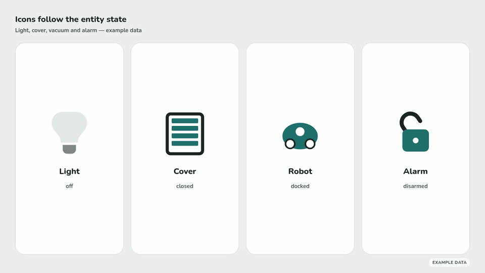
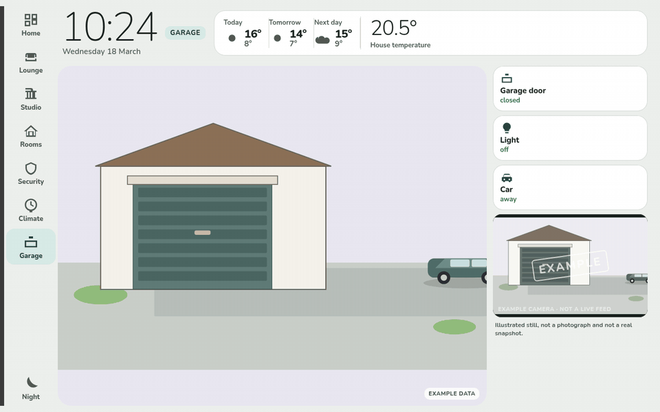
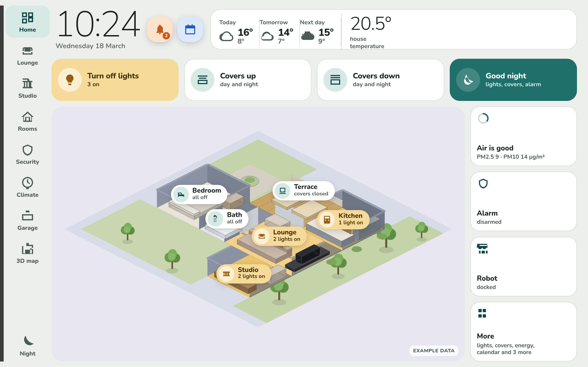
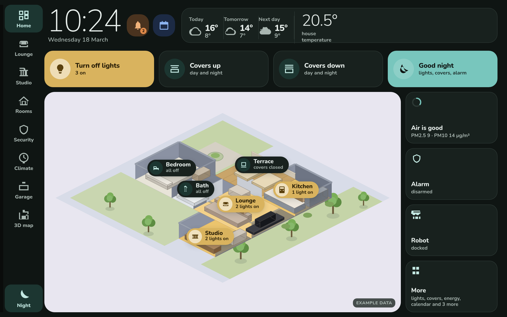
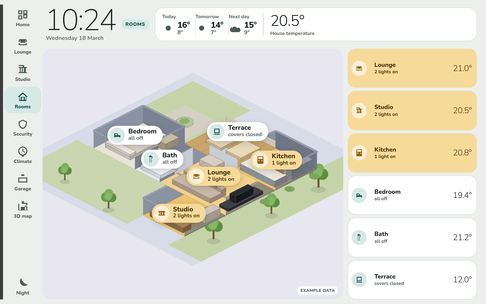
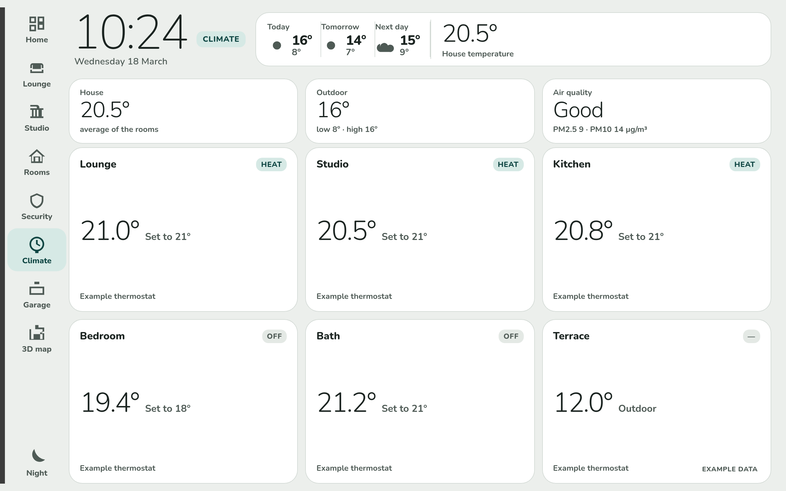
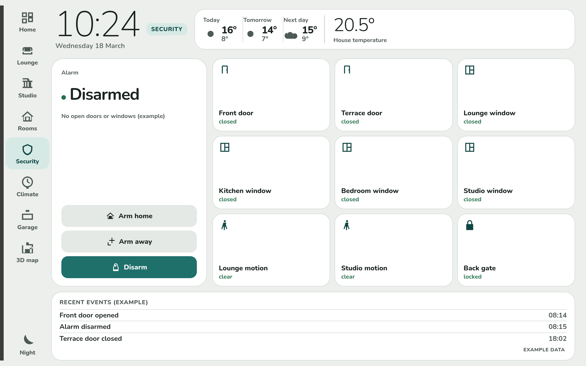
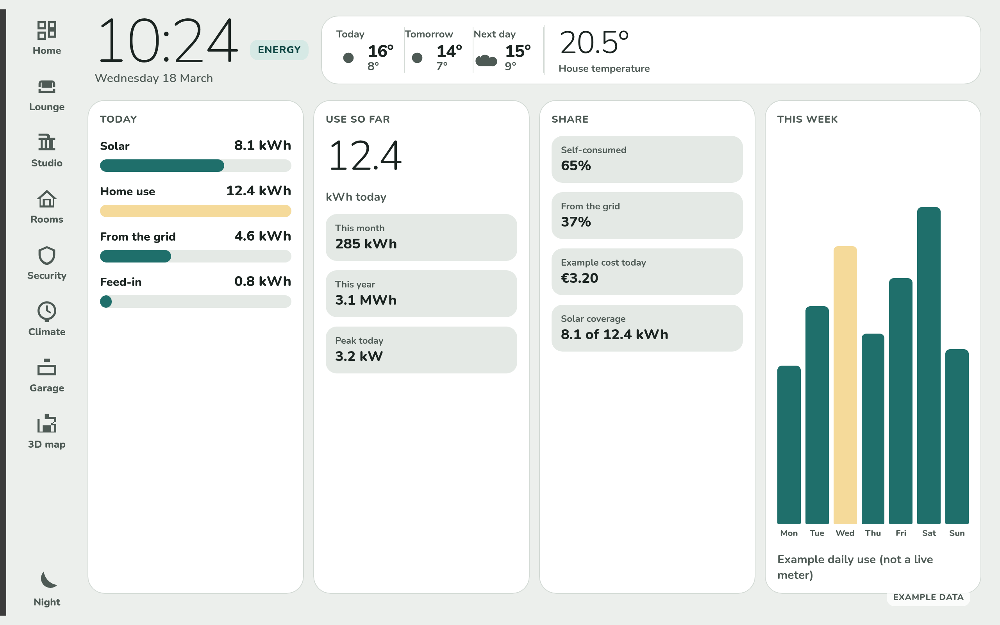
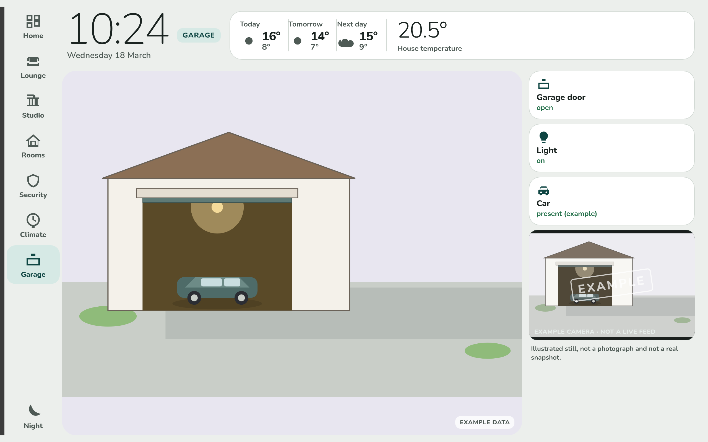
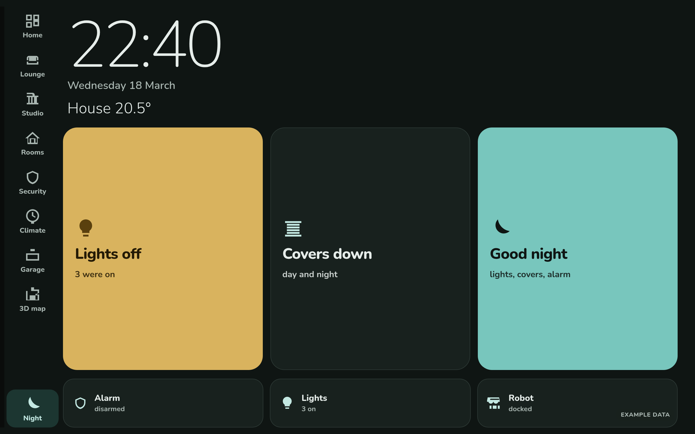

# Example Home — a custom Home Assistant dashboard

A tablet-first dashboard built on top of Home Assistant: a left rail, a large clock, day and night palettes, a 3D plan with room states on it, further views for rooms, climate, security, energy and a night wall, plus an animated garage scene.

The images below use **example data** and a **fictional apartment and garage**. They show the interface, not a real house. This public edition is a **cleaned, reduced example** — not a drop-in copy of a live configuration, and not a HACS package.

Public repository: [github.com/frazekz/ha-dashboard](https://github.com/frazekz/ha-dashboard)





## What's different

When a project takes cues from work that already does something well, it should also add something of its own and say so. The three points below are the differences that are actually in this repo. This is a reduced personal edition: not a fork, not a HACS product, and not a claim that it is “better” overall.

**The home is the plan.** The home view is built around a 3D plan, with lights and covers shown on the rooms themselves, rather than a floorplan card sitting beside a separate dashboard. [matt8707/hass-config](https://github.com/matt8707/hass-config) is a grid of highly finished cards — it remains the reference we looked at for icon motion, packages, and README layout. [ExperienceLovelace/ha-floorplan](https://github.com/ExperienceLovelace/ha-floorplan) is a floorplan *library* you place in a card. [willsanderson/Hemma](https://github.com/willsanderson/Hemma) is a packaged dashboard you install from HACS. This repo is none of those three: a small personal config whose home screen *is* the plan.

**A day/night design system, a night-wall view, and a garage scene.** Sage by day, near-black by night, with the plan kept on a light base; a Night wall view with a large clock for a hallway tablet; and a Garage view where the door, the light and a generic car follow example states. The garage “camera” is an illustrated still with an Example label, not a live feed and not a real snapshot. We do not claim better icon animation than matt8707 — his state-based CSS animations are the idea we followed, with our own drawings and colours.

**A documented, human-approved way of changing the system.** [docs/ai-assisted-workflow.md](docs/ai-assisted-workflow.md) is the method used on this project: read-only study, a backup, a local draft, one change at a time, an explicit human yes, rollback, and a short log. An assistant may draft YAML and documentation. It does not write to a live Home Assistant on its own.

## Screenshots

**Home, day**



**Home, night**



**Rooms**



**Climate**



**Security** (door and window sensors; no real cameras)



**Energy**



**Garage** (invented illustration; the camera card is a labelled still, not a feed)



**Night wall**



## Features

- Day and night palettes (light sage background by day, near-black by night; the plan stays on a light base)
- Room state shown on a 3D plan (lights on/off, covers open/closed) — the published plan is invented
- Icon CSS animations that follow entity state (light, cover, vacuum, alarm), in this dashboard's colour system
- A Rooms overview with the same fictional plan and per-room tiles (temperature, lights, covers)
- Climate tiles for each example room, plus house, outdoor and air-quality summaries
- A Security view with alarm modes and door/window/motion sensors — **no camera feeds**
- An Energy view with example use, solar, grid and weekly totals
- A Garage view with an invented scene (door, light, generic car) and an illustrated camera still
- A Night wall view: large clock and a few big actions for a hallway tablet
- Quick actions for lights, covers, and a good-night scene
- Example packages: good-night and good-morning scripts, presence lighting, sun-linked covers, sensor alerts, connectivity alerts, tablet night mode, and a garage arrival / open-door reminder
- Side rail for Home, rooms, climate, security, garage, and a 3D map shortcut
- YAML-mode Lovelace, so the layout lives in the repo
- Built for a landscape tablet; kiosk mode can hide the default header and sidebar

## How it works

Home Assistant entities expose a state. `button-card` templates in `button_card_templates/` map that state to a label, a colour and, where it helps, a short CSS animation (a bulb that glows when the light is on, slats that rise when a cover is open, and so on). The views in `views/` compose those templates with the rail, the clock, and — on Home and Rooms — the fictional 3D plan.

Scripts and automations in `packages/` change the same example entities. Two helpers are kept separate on purpose: `input_boolean.good_night_active_example` is the evening *scene* (lights off, covers closed, alarm armed home); `input_boolean.night_mode_example` is only the tablet *palette*. The good-night script turns both on. The good-morning script clears the scene helper and leaves the palette to you (or to the optional sunrise automation in `packages/tablet_night.yaml`).

## Automations

These are generic examples, written so you can read the intent and then point them at your own entities. They notify with `persistent_notification` only.

- **Good night / good morning** (`packages/good_night.yaml`). Good night turns off the example lights, turns off an outdoor light switch, closes the day and night cover groups, arms the alarm home, and sets both helpers. Good morning opens the covers and clears the good-night helper only.
- **Lights by presence and time** (`packages/lights.yaml`). After sunset, lounge motion turns the lounge light on and, after a short idle, off again — unless the good-night helper is already on.
- **Covers with the sun** (`packages/covers_sun.yaml`). An example pattern on top of the day/night cover groups: open a short while after sunrise (unless good night is still active), close a short while after sunset. This is a hook you can adapt, not a claim that a live house uses exactly these offsets.
- **Sensor alerts** (`packages/sensor_alerts.yaml`). If a door or window opens while the alarm is not disarmed, raise a persistent notification.
- **Tablet night mode** (`packages/tablet_night.yaml`). Optionally clear the night palette a while after sunrise.
- **Garage** (`packages/garage.yaml`). When the example car-present sensor turns on, turn the garage light on. If the garage door stays open for 15 minutes, or if good night starts while the door is open, raise a persistent notification.
- **Connectivity alerts** (`packages/connectivity_alerts.yaml`). Raise a notification when both WAN latency probes are missing, or the gateway is offline, for 5 minutes; send "restored" only from inside that same run, so a router integration reload never produces a false "restored" message. A second example does the same for one network device, and stays quiet while the whole internet is down.

## Installation / How to adapt

This is **not** a HACS package and it will not configure a house for you. See [INSTALL.md](INSTALL.md) for the steps: required custom cards, where to copy files, how to load the example packages, and how to point the views at your entities and your own plan image.

## Structure

```
configuration.yaml          # YAML-mode Lovelace, theme include, packages include
ui-lovelace.yaml            # dashboard entry, templates, view includes
views/home.yaml             # home view (plan-centred)
views/rooms.yaml            # rooms overview
views/climate.yaml          # climate
views/security.yaml         # alarm and sensors (no real cameras)
views/energy.yaml           # energy example
views/garage.yaml           # invented garage scene
views/night.yaml            # night wall tablet
button_card_templates/      # base, rail, actions, status, room, climate, meters, animated icons
packages/                   # example helpers, scripts and automations
themes/example-home.yaml    # day / night colour tokens
docs/ai-assisted-workflow.md
www/img/                    # example screenshots, GIFs, fictional plan, garage stills
INSTALL.md                  # how to adapt this, not a one-click install
LICENSE                     # MIT, Copyright (c) 2026 frazekz
```

Entity ids in this repo are generic English placeholders, for example `light.lounge_example`, `cover.garage_door_example`, `binary_sensor.car_present_example`. Swap them for your own. The garage camera card is a still at `/local/img/example-garage-camera.png`, not a `camera.` entity and not a live feed.

## Design decisions

<details>
<summary>Why the helpers, notifications, images and packages are shaped this way</summary>

- The good-night *scene* and the tablet *palette* are two helpers, because you may want the evening routine without forcing the night theme, or the other way around.
- Notifications in the example packages use `persistent_notification` only, so the public edition has no vendor or phone-app identifiers.
- The published plan and the garage illustration are invented. The garage camera card is a still with an Example label. There are no real camera frames, no number plates, and no vehicle brands.
- Icon motion follows the idea in [matt8707/hass-config](https://github.com/matt8707/hass-config) (animate from entity state with CSS). The SVGs and keyframes here are original; his `icons.yaml` was not copied.
- `packages/covers_sun.yaml` is an example hook on the day/night cover groups used by the scripts. The comments in that file say so; the README does not pretend it is a verbatim live automation.
- Packages are included with `!include_dir_named packages`, the same pattern used in well-known public configs, so related scripts and automations stay together.

</details>

## Changelog

A short history of this *public* edition only. No live entity ids, and no personal data.

- Reduced public edition: home view, day/night theme, and a small set of `button-card` templates, with a fictional plan and example data.
- Further views rewritten in the same style: Rooms, Climate, Security (sensors only), Energy, and Night wall.
- Packages for example automations and scripts; state-based icon animations; Garage view with an invented scene and illustrated camera still; GIFs of the icon and garage transitions; the AI-assisted workflow written down in `docs/`.
- Connectivity alerts package: internet-down alert with two probes and a delay, restore message only after a down alert, and a device-offline example.

## Credits

This dashboard depends on these third-party Lovelace cards and components:

- [custom-cards/button-card](https://github.com/custom-cards/button-card) — templates, rail, actions, status chips
- [thomasloven/lovelace-card-mod](https://github.com/thomasloven/lovelace-card-mod) — used in the live setup this example is based on; keep it if you extend the styles
- [NemesisRE/kiosk-mode](https://github.com/NemesisRE/kiosk-mode) — hides the default header and sidebar on a wall tablet

The layout, colour system, plan, garage illustration and icon drawings are original to this edition. The published 3D plan is a fictional example house, not a survey of a real apartment.

README structure, the use of `packages/`, and the idea of CSS icon animations based on entity state are indebted to [matt8707/hass-config](https://github.com/matt8707/hass-config) (see in particular the [Features section and animations GIF](https://github.com/matt8707/hass-config#features) and [`button_card_templates/icons.yaml`](https://github.com/matt8707/hass-config/blob/master/button_card_templates/icons.yaml)). That project is a personal config, now marked unmaintained, with [ha-fusion](https://github.com/matt8707/ha-fusion) as its successor. This repo is not a fork of either.

[ExperienceLovelace/ha-floorplan](https://github.com/ExperienceLovelace/ha-floorplan) and [willsanderson/Hemma](https://github.com/willsanderson/Hemma) are listed under What's different for comparison; they are not dependencies of this edition.

## License

The code and YAML in this repository are released under the [MIT License](LICENSE), Copyright (c) 2026 frazekz. Screenshots, GIFs, the fictional plan and the invented garage illustration may be reused under the same terms. Please keep the credits for the third-party cards.
